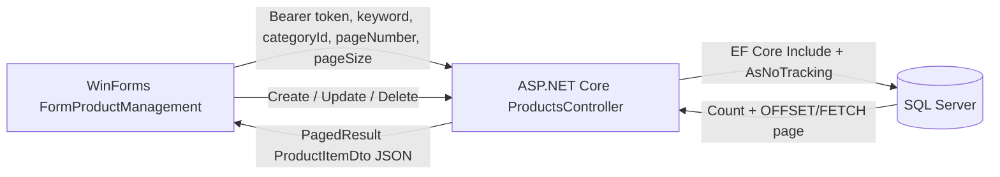

# BUỔI 6 — EF CORE NÂNG CAO, PHÂN TRANG LINQ VÀ TÍCH HỢP POS

**Dự án:** Hệ thống quản lý bán lẻ Tiệm Tạp hóa Ngọc Mai  
**Môn học:** Lập trình Ứng dụng (229162)  
**Sinh viên:** Nguyễn Thị Mộng Tuyền  
**Mã số sinh viên:** 2124110290  
**Lớp học phần:** CCQ2411D  
**Công nghệ:** C#/.NET 8, ASP.NET Core Web API, Entity Framework Core, WinForms, SQL Server

## 1. Mục tiêu thực hành

- Dùng EF Core `Include` để lấy sản phẩm cùng danh mục, tránh truy vấn N+1.
- Tìm kiếm và lọc dữ liệu ở SQL Server thay vì tải toàn bộ sản phẩm về WinForms.
- Phân trang phía máy chủ bằng LINQ `OrderBy`, `Skip`, `Take`, `CountAsync` và `AsNoTracking`.
- Hiển thị metadata phân trang trên WinForms và gọi API bằng `HttpClient` bất đồng bộ.
- Giữ nguyên phân quyền: Admin/Warehouse quản lý sản phẩm; Cashier chỉ xem danh sách để bán hàng.

## 2. Luồng dữ liệu



## 3. API sản phẩm phân trang

```http
GET /api/products/paged?keyword=Coca&pageNumber=1&pageSize=5&categoryId=2
Authorization: Bearer <token>
```

Tham số `keyword` và `categoryId` là tùy chọn. `pageNumber` bắt đầu từ 1; `pageSize` mặc định là 5 và giới hạn tối đa 50. Nếu trang yêu cầu vượt quá trang cuối, API tự điều chỉnh về trang hợp lệ. Tìm kiếm kiểm tra tên sản phẩm hoặc mã vạch; bộ lọc nhóm hàng và từ khóa đều được áp dụng ở server trước khi phân trang.

Ví dụ response:

```json
{
  "currentPage": 1,
  "pageSize": 5,
  "totalItems": 15,
  "totalPages": 3,
  "items": [
    {
      "productId": 1,
      "barcode": "893456789001",
      "productName": "Snack Oishi Cay 42g",
      "price": 7000,
      "stockQuantity": 100,
      "categoryId": 1,
      "categoryName": "Bánh kẹo & Đồ ăn vặt"
    }
  ]
}
```

Tên và số lượng bản ghi trong response thực tế phụ thuộc dữ liệu CSDL đang kết nối.

### Truy vấn EF Core

Endpoint bắt đầu bằng `_context.Products.Include(p => p.Category).AsNoTracking()`, sau đó áp dụng điều kiện tìm kiếm/lọc, đếm tổng số dòng, sắp xếp ổn định theo `ProductId`, rồi mới `Skip` và `Take`. Dữ liệu của trang được ánh xạ sang `ProductItemDto` có `CategoryName`.

EF Core sinh truy vấn dạng SQL Server tương đương:

```sql
SELECT p.ProductId, p.Barcode, p.ProductName, p.Price,
       p.StockQuantity, p.CategoryId, c.CategoryName
FROM Products AS p
LEFT JOIN Categories AS c ON p.CategoryId = c.CategoryId
ORDER BY p.ProductId
OFFSET 0 ROWS FETCH NEXT 5 ROWS ONLY;
```

`Skip((pageNumber - 1) * pageSize)` được SQL Server thực hiện bằng `OFFSET`; `Take(pageSize)` thành `FETCH NEXT`. Câu lệnh `CountAsync` được chạy riêng để điền `TotalItems` và `TotalPages`. Có thể xem SQL trong cửa sổ Output của Visual Studio khi chạy API ở Development; EF Core mặc định không ghi giá trị tham số nhạy cảm vào log.

## 4. API khách hàng phân trang mở rộng

```http
GET /api/customers/paged?pageNumber=1&pageSize=10
Authorization: Bearer <token>
```

Endpoint sắp xếp `RewardPoints` giảm dần, sau đó theo `CustomerId` để thứ tự ổn định; response dùng cùng metadata `CurrentPage`, `PageSize`, `TotalItems`, `TotalPages`, `Items`. Kích thước trang mặc định là 10, tối đa 100.

## 5. Tích hợp màn hình WinForms

`FormProductManagement` gọi `products/paged` qua `ApiClientService.Client`. Dịch vụ này đã gắn Bearer token sau đăng nhập. Màn hình hỗ trợ:

- Tải danh mục lên ComboBox và lọc theo nhóm hàng (Admin/Warehouse).
- Tìm theo tên hoặc mã vạch; thay đổi từ khóa/nhóm hàng sẽ tải lại từ trang 1.
- Hiển thị DataGridView, tên nhóm hàng và tổng số kết quả.
- Nút **Trang trước**/**Trang sau** được bật tắt theo metadata.
- Thêm, cập nhật, xóa sản phẩm qua API; lỗi HTTP hiển thị mã trạng thái và nội dung server.
- Cashier xem/tìm/phân trang sản phẩm; form ẩn khu vực sửa và API vẫn chặn CRUD theo role.

## 6. Cấu hình và chạy

Thông tin kết nối SQL Server và khóa session không lưu trong Git. Tạo User Secrets từ thư mục gốc repo:

```powershell
dotnet user-secrets init --project MiniSupermarket.API
dotnet user-secrets set "ConnectionStrings:DefaultConnection" "Server=<SQL_SERVER>;Database=<DATABASE_NAME>;Trusted_Connection=True;TrustServerCertificate=True;MultipleActiveResultSets=true;" --project MiniSupermarket.API
dotnet user-secrets set "JwtSettings:Secret" "<YOUR_RANDOM_SECRET_AT_LEAST_32_BYTES>" --project MiniSupermarket.API
```

Thay các giá trị mẫu bằng cấu hình riêng trên máy. Sau đó:

1. Mở solution trong Visual Studio và chạy `MiniSupermarket.API`.
2. Đăng nhập WinForms bằng tài khoản đã có trong bảng `Users`; token được gắn vào các request API.
3. Mở màn hình **Quản lý Sản phẩm** để thử tìm kiếm, lọc, chuyển trang và CRUD theo quyền.
4. Dùng Swagger để gọi endpoint phân trang và xem metadata trả về.

## 7. File chính

- `MiniSupermarket.API/Models/PagedResult.cs` — DTO metadata và các dòng sản phẩm/khách hàng.
- `MiniSupermarket.API/Controllers/ProductsController.cs` — phân trang, tìm kiếm và lọc sản phẩm bằng EF Core.
- `MiniSupermarket.API/Controllers/CustomersController.cs` — phân trang khách hàng theo điểm thưởng.
- `MiniSupermarket.WinForms/FormProductManagement.cs` — gọi API, cập nhật lưới và điều khiển trang.
- `MiniSupermarket.WinForms/FormProductManagement.Designer.cs` — nút và nhãn phân trang.
- `MiniSupermarket.WinForms/Models/DtoModels.cs` — DTO nhận JSON ở client.

## 8. Tiêu chí đối soát

- Gọi trang đầu với `pageSize=5`: `Items` tối đa 5 dòng, metadata phản ánh tổng phù hợp dữ liệu CSDL.
- Mỗi sản phẩm trả kèm `CategoryName`.
- Tìm `Coca` hoặc truyền `categoryId` chỉ lọc kết quả phù hợp và tính lại tổng trang.
- Chuyển trang trên WinForms thay đổi dữ liệu mà không tải toàn bộ bảng sản phẩm.
- CRUD cập nhật qua API; Cashier bị từ chối nếu gọi API ghi dữ liệu trực tiếp.
- `/api/customers/paged` sắp xếp điểm thưởng giảm dần.
