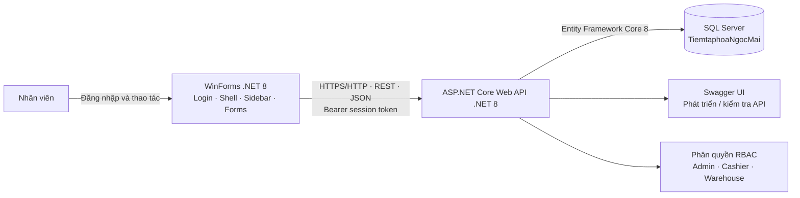
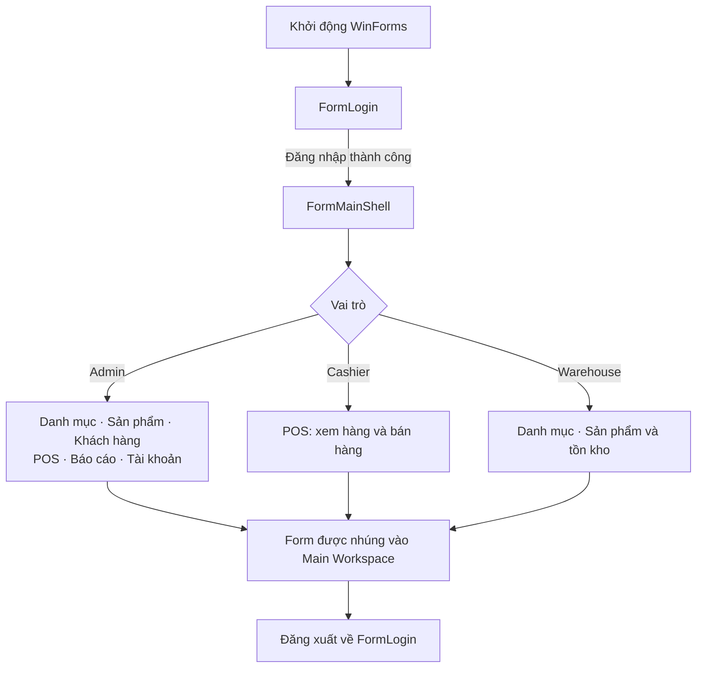
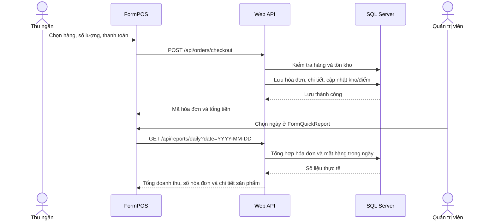

# 🛒 Tiệm Tạp hóa Ngọc Mai

**Nghiên cứu và hiện thực hóa phần mềm quản lý bán lẻ theo kiến trúc Client–Server**
**Môn học:** Lập trình Ứng dụng .NET Core — 229162
**Buổi thực hành:** Buổi 4 — WinForms Shell, Sidebar và phân quyền RBAC
**Sinh viên:** Nguyễn Thị Mộng Tuyền · **MSSV:** 2124110290 · **Lớp:** CCQ2411D

Ứng dụng quản lý bán hàng gồm máy chủ ASP.NET Core Web API, cơ sở dữ liệu SQL Server và ứng dụng máy trạm Windows Forms. Nhân viên đăng nhập, nhìn thấy các màn hình phù hợp với vai trò; thu ngân bán hàng tại POS, còn quản trị viên theo dõi doanh thu thực tế từ hóa đơn đã lưu.

## Sơ đồ kiến trúc



### Thành phần chính

| Thành phần | Vai trò |
|---|---|
| `MiniSupermarket.WinForms` | Giao diện desktop, đăng nhập, sidebar và các màn hình nghiệp vụ; gọi API bằng `HttpClient` và hiển thị dữ liệu bằng `DataGridView`. |
| `MiniSupermarket.API` | Xác thực phiên, phân quyền, xử lý nghiệp vụ và cung cấp REST API. |
| SQL Server | Lưu tài khoản, sản phẩm, danh mục, khách hàng, hóa đơn và chi tiết hóa đơn. |
| Swagger UI | Giao diện kiểm tra API trong môi trường Development. |

## Sơ đồ đăng nhập và điều hướng



`FormMainShell` giữ Sidebar và vùng làm việc chính. Khi chọn mục menu, form tương ứng được nhúng vào vùng nội dung thay vì mở thêm cửa sổ độc lập. Quyền được kiểm tra ở giao diện và các API nghiệp vụ.

## Chức năng giao diện

| Form | Chức năng |
|---|---|
| `FormLogin` | Đăng nhập qua API; có danh sách tài khoản mẫu để chọn nhanh. |
| `FormMainShell` | Hiển thị nhân viên/vai trò, điều hướng Sidebar, nhúng form con và đăng xuất. |
| `FormCategoryManagement` | Tải, tìm kiếm, thêm, sửa và xóa danh mục. |
| `FormProductManagement` | Quản lý sản phẩm, giá, mã vạch, danh mục và tồn kho. |
| `FormCustomerManagement` | Quản lý thông tin khách hàng và điểm thưởng. |
| `FormPOS` | Tìm/chọn sản phẩm, lập giỏ hàng, thanh toán và lưu hóa đơn; API kiểm tra tồn kho trước khi bán. |
| `FormQuickReport` | Chọn ngày, xem tổng hóa đơn, tổng doanh thu, sản phẩm bán chạy và bảng doanh thu theo mặt hàng. Dữ liệu lấy từ API và SQL Server, không phải số liệu minh họa ngẫu nhiên. |
| `FormUserManagement` | Quản trị tài khoản người dùng (Admin). |
| `FormRoleManagement` | Form/API minh họa quản lý vai trò; hiện chưa được gắn vào Sidebar chính. Vai trò API hiện lưu trong bộ nhớ. |

## Phân quyền RBAC

| Vai trò | Quyền trên giao diện |
|---|---|
| **Admin** | Danh mục, sản phẩm, khách hàng, POS, báo cáo doanh thu và tài khoản. |
| **Cashier** | Chỉ POS: xem sản phẩm còn hàng và lập giao dịch bán. Không quản lý sản phẩm, danh mục, khách hàng hay tài khoản. |
| **Warehouse** | Danh mục, sản phẩm và tồn kho; không truy cập POS, báo cáo hoặc tài khoản. |

API áp dụng kiểm tra vai trò cho các thao tác được bảo vệ; đăng nhập và kiểm tra tình trạng API là các endpoint công khai. Phiên đăng nhập API dùng bearer token trong bộ nhớ máy chủ và hết hạn sau một khoảng thời gian.

## Luồng bán hàng và báo cáo doanh thu



Báo cáo chỉ tổng hợp các hóa đơn được lưu kể từ khi chức năng lưu hóa đơn được bật. Giao dịch cũ trước thời điểm đó không có dữ liệu hóa đơn để truy xuất.

## Công nghệ

- **Ngôn ngữ/nền tảng:** C#, .NET 8.0
- **Backend:** ASP.NET Core Web API, Controllers, LINQ, Swagger/Swashbuckle
- **Cơ sở dữ liệu:** Microsoft SQL Server, Entity Framework Core 8
- **Frontend:** Windows Forms, `HttpClient`, `System.Net.Http.Json`, `DataGridView`
- **Phân quyền:** Role-Based Access Control (Admin / Cashier / Warehouse)

## Cấu trúc solution

```text
MiniSupermarket.API.sln
├── MiniSupermarket.API/
│   ├── Controllers/       # API tài khoản, danh mục, sản phẩm, khách hàng,
│   │                      # bán hàng, báo cáo và vai trò
│   ├── Data/              # SupermarketDbContext và dữ liệu khởi tạo
│   ├── Models/            # Thực thể và DTO dữ liệu
│   ├── Security/          # Phiên bearer token
│   ├── Properties/        # Cấu hình profile chạy API
│   ├── Program.cs         # DI, SQL Server, Swagger, xác thực và middleware
│   └── appsettings.json   # Chuỗi kết nối cơ sở dữ liệu
└── MiniSupermarket.WinForms/
    ├── ApiClientService.cs
    ├── FormLogin.cs
    ├── FormMainShell.cs
    ├── FormCategoryManagement.cs
    ├── FormProductManagement.cs
    ├── FormCustomerManagement.cs
    ├── FormPOS.cs
    ├── FormQuickReport.cs
    └── FormUserManagement.cs
```

## Cài đặt và chạy bằng Visual Studio 2022

### Yêu cầu

- Windows và Visual Studio 2022 có workload **.NET desktop development** và **ASP.NET and web development**.
- .NET 8 SDK.
- SQL Server/SQL Server Express đang chạy và có quyền truy cập Windows Authentication.

### 1. Cấu hình cơ sở dữ liệu

Mở `MiniSupermarket.API/appsettings.json`, kiểm tra `ConnectionStrings:DefaultConnection` phù hợp với máy đang chạy SQL Server. Mặc định project dùng:

```text
Server=localhost;Database=TiemtaphoaNgocMai;Trusted_Connection=True;TrustServerCertificate=True;MultipleActiveResultSets=true;
```

Khi API khởi động, `EnsureCreated` tạo cơ sở dữ liệu nếu chưa có; phần khởi tạo bổ sung các bảng hóa đơn nếu chúng chưa tồn tại. Không xóa cơ sở dữ liệu hiện có.

### 2. Khởi động API

1. Mở `MiniSupermarket.API.sln` trong Visual Studio.
2. Chọn project `MiniSupermarket.API` làm Startup Project.
3. Chọn profile **https** hoặc **http**, sau đó nhấn **F5**.
4. Profile mặc định dùng `https://localhost:7118` và `http://localhost:5186`; Swagger mở tại `/swagger` trong Development.
5. Giữ API chạy trong lúc sử dụng WinForms.

### 3. Khởi động WinForms

1. Chọn `MiniSupermarket.WinForms` làm Startup Project hoặc nhấp phải project và chọn **Debug → Start New Instance**.
2. Chạy ứng dụng. Màn hình đầu tiên là đăng nhập; có thể chọn nhanh một tài khoản mẫu trong danh sách.
3. Đăng nhập với tài khoản được khởi tạo trong cơ sở dữ liệu. Tài khoản mẫu mặc định dùng mật khẩu `123456`.
4. Chọn chức năng trên Sidebar theo vai trò. Admin mở **Báo cáo Doanh thu**, chọn ngày và nhấn **Xem Báo Cáo**.

`ApiClientService` tự dò API tại `http://localhost:5186` và `https://localhost:7118`. Nếu thay đổi cổng, cập nhật cấu hình profile API và danh sách địa chỉ trong `ApiClientService` cho khớp.

> Đăng nhập offline bằng tài khoản mẫu chỉ cho phép vào giao diện; các chức năng cần dữ liệu vẫn cần API và SQL Server hoạt động.

## API chính

| Phương thức | Đường dẫn | Mục đích |
|---|---|---|
| `POST` | `/api/users/login` | Đăng nhập, nhận bearer token. |
| `GET` | `/api/users/health` | Kiểm tra API sẵn sàng. |
| `GET` | `/api/categories` | Lấy danh sách danh mục. |
| `GET` | `/api/products` | Lấy danh sách sản phẩm. |
| `POST` | `/api/orders/checkout` | Thanh toán, lưu hóa đơn và cập nhật tồn kho. |
| `GET` | `/api/reports/daily?date=2026-10-22` | Báo cáo bán hàng theo ngày (Admin). |

Các API quản lý khác có thể xem đầy đủ trong Swagger sau khi chạy API.

## Tài khoản mẫu

Tài khoản mẫu được khai báo trong dữ liệu khởi tạo của `SupermarketDbContext`. Một số tài khoản để đăng nhập nhanh:

| Vai trò | Tên đăng nhập | Mật khẩu |
|---|---|---|
| Admin | `admin01` | `123456` |
| Thu ngân | `cashier01` | `123456` |
| Thủ kho | `ware01` | `123456` |

Đây là thông tin phục vụ demo môn học; hãy đổi thông tin xác thực nếu triển khai ngoài môi trường học tập.

👨‍💻 5. Tác giả
Họ tên sinh viên: [Nguyễn Thị Mộng Tuyền]


Mã sinh viên: [2124110290]


Lớp học phần: [CCQ2411D]
